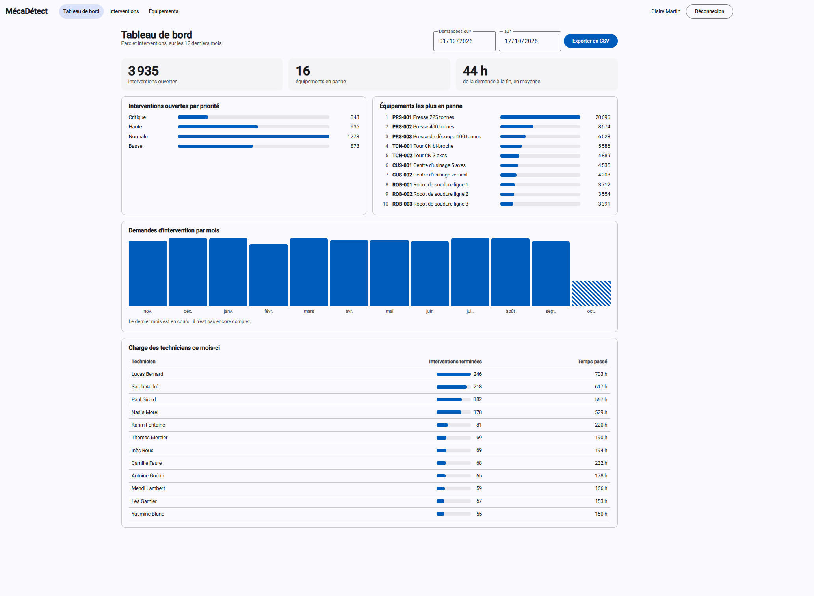
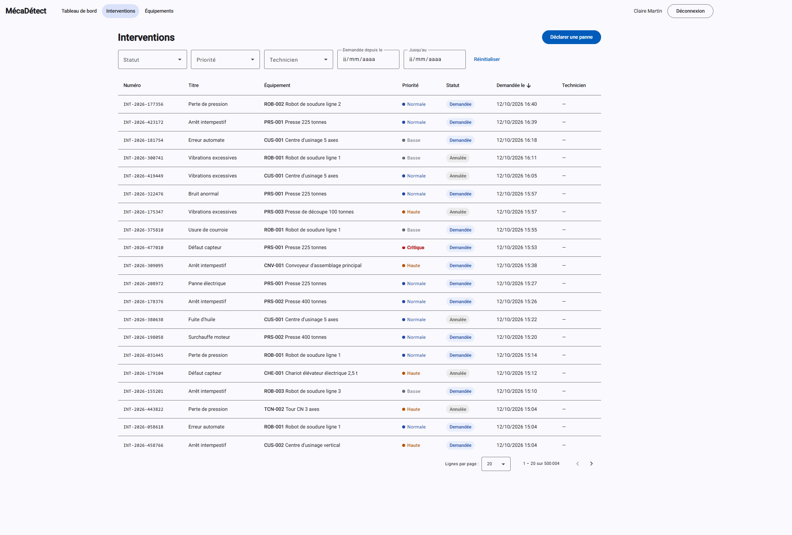
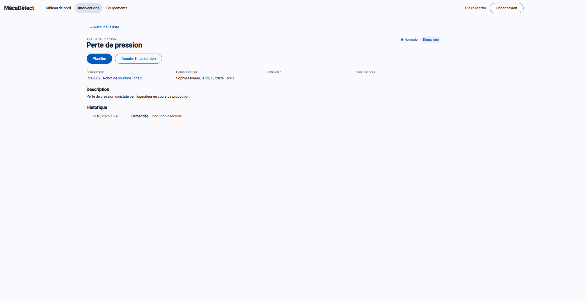
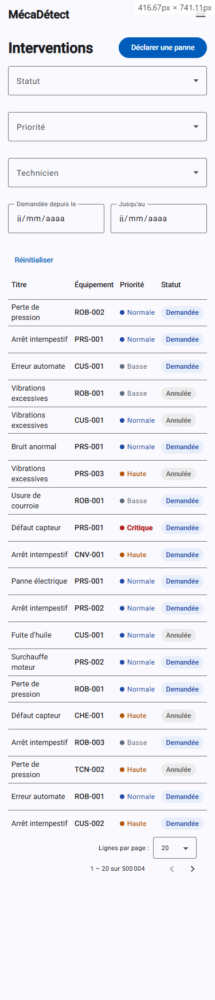
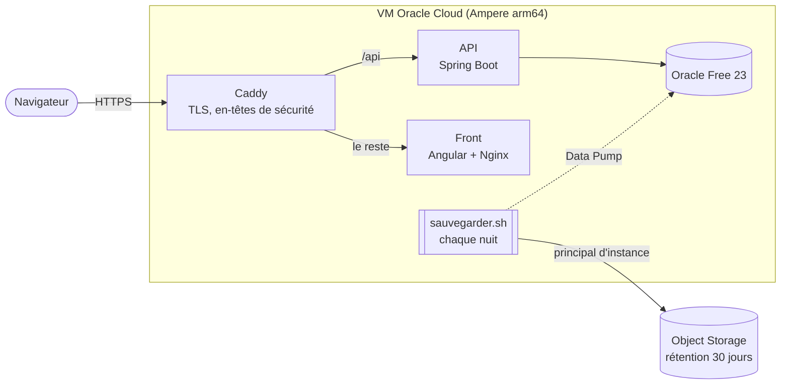
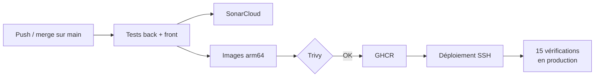

# MécaDétect

[](https://github.com/Matfen2/mecadetect/actions/workflows/ci.yml)
[](https://github.com/Matfen2/mecadetect/actions/workflows/dependances.yml)
[](https://sonarcloud.io/summary/new_code?id=Matfen2_mecadetect)
[](https://sonarcloud.io/summary/new_code?id=Matfen2_mecadetect)

Application de suivi de maintenance industrielle : déclaration des pannes, planification des interventions et pilotage du parc d'équipements.

**▶ Démo en ligne : [mecadetect.duckdns.org](https://mecadetect.duckdns.org)** (comptes ci-dessous). La base de démonstration contient 200 000 interventions sur 3 ans et est remise à neuf chaque nuit.

| Rôle | Email | Mot de passe |
| --- | --- | --- |
| Responsable maintenance | admin@mecadetect.fr | Demo2026! |
| Technicien | technicien@mecadetect.fr | Demo2026! |
| Demandeur | demandeur@mecadetect.fr | Demo2026! |

## Aperçu

| Tableau de bord | Liste des interventions |
| --- | --- |
|  |  |

| Détail d'une intervention | Sur téléphone |
| --- | --- |
|  |  |

## Stack technique

| Couche | Technologies |
| --- | --- |
| Back-end | Java 25 (LTS), Spring Boot 4, Spring Data JPA / Hibernate, Spring Security (JWT) |
| Base de données | Oracle Database Free 23, Flyway, PL/SQL, Data Pump |
| Front-end | Angular 21 (standalone, signals), Angular Material, RxJS |
| Contrat d'API | OpenAPI 3 en contract-first, avec génération des interfaces Spring et du client Angular |
| Tests | JUnit 5, AssertJ, Mockito, Testcontainers (Oracle), Vitest, Gatling (charge) |
| Qualité et sécurité | SonarQube Cloud, JaCoCo, Trivy, OWASP Dependency-Check, npm audit |
| Déploiement | Docker (images multi-étapes arm64), Docker Compose, Caddy (HTTPS), GitHub Actions, GHCR, Oracle Cloud (VM Ampere, Object Storage) |

## Points clés

### Conception et code

- **Contract-first** : le fichier [`api/openapi.yaml`](api/openapi.yaml) est la source de vérité de l'API. Les interfaces Spring et le client Angular sont générés à chaque build : une incompatibilité entre le back et le front est détectée à la compilation.
- **Cycle de vie modélisé en Java moderne** : les transitions d'une intervention (planification, démarrage, clôture, annulation) sont une `sealed interface` de records, traitée par un `switch` à pattern matching exhaustif. Toute transition non prévue lève une exception métier, et le compilateur signale un cas oublié.
- **Concurrence maîtrisée** : verrouillage optimiste (`@Version`). Si deux responsables planifient la même intervention en même temps, le second reçoit un 409 et l'interface lui propose de recharger. Un test lance réellement les deux transactions concurrentes.
- **Règles métier garanties par la base** : contraintes nommées et `CHECK` Oracle (une intervention terminée a obligatoirement un compte rendu, une intervention annulée un motif…).
- **Sécurité** : API sans état, JWT signé via le support natif de Spring Security (clé de 256 bits minimum, contrôlée au démarrage), autorisations par rôle, erreurs au format Problem Details (RFC 9457).

### Oracle et performance

- **Performance mesurée sur 500 000 interventions** : un package PL/SQL génère 5 ans d'historique réaliste en 41 s. Plans d'exécution analysés, index ciblés, recherche construite dynamiquement (Criteria API) : la première page de la liste passe de 480 ms à moins de 7 ms. Le problème N+1 est démontré puis corrigé par un test qui compte les requêtes SQL (41 requêtes contre 2). Le détail est dans [`docs/PERFORMANCE.md`](docs/PERFORMANCE.md).
- **Tests de charge Gatling** : 35 utilisateurs simultanés (responsables, techniciens, demandeurs), avec des objectifs vérifiés automatiquement. La campagne a révélé deux défauts que les tests fonctionnels ne voyaient pas, diagnostiqués dans `V$SQL` puis corrigés : p95 de 403 ms à 21 ms, contre 3,1 s sans les index.
- **Oracle avancé** : historique des statuts alimenté par trigger, reporting en SQL analytique (`RANK`, `LAG`, calendrier `CONNECT BY`), archivage par lots en PL/SQL (`BULK COLLECT`, `FORALL`, journal en transaction autonome) appelé depuis l'API par `SimpleJdbcCall`.

### Produit

- **Tableau de bord** du responsable : interventions ouvertes par priorité, équipements en panne, temps moyen de réparation, charge des techniciens, et **export CSV** des interventions d'une période.
- **Interface pensée pour le terrain** : la page « Mes interventions » du technicien fonctionne sur tablette et sur téléphone, et le démarrage comme la clôture se font en 2 clics. Sur petit écran, la navigation se replie dans un menu et les tableaux n'affichent que les colonnes utiles.

### Production

- **Pipeline complet à chaque merge sur `main`** : tests back et front, analyse SonarCloud, construction des images arm64, **scan Trivy** (une faille critique ou haute corrigeable bloque la publication), publication sur GHCR, déploiement par SSH (empreinte du serveur épinglée, clé dédiée), puis 15 vérifications automatiques du site en production.
- **Conteneurs durcis** : utilisateurs non root, système de fichiers en lecture seule, aucune capacité Linux superflue, réseau interne sans accès à Internet pour l'API et la base. Seul Caddy est exposé, avec HTTPS automatique (Let's Encrypt), HTTP/3 et en-têtes de sécurité (CSP stricte, HSTS…).
- **Sauvegardes testées** : export Data Pump chaque nuit, compressé et signé (SHA-256), copié dans Oracle Object Storage. La VM s'y authentifie par **principal d'instance**, sans aucune clé stockée, et ne peut ni écraser ni supprimer une sauvegarde. Un **test de restauration** automatique recharge chaque semaine la dernière sauvegarde dans un schéma temporaire et compare, table par table, le nombre de lignes avec l'export.
- **Dépendances surveillées** : OWASP Dependency-Check (base NVD) et `npm audit` chaque semaine et à chaque changement de dépendances, résultats publiés dans l'onglet *Security* de GitHub.

## Architecture de production





## Modélisation

Modèle conceptuel (méthode Merise, réalisé avec Looping) :


Modèle logique :


La [documentation technique complète](docs/MecaDetect_Documentation_technique.pdf) détaille la vision produit, l'architecture, les cas d'usage base de données et le découpage en sprints.

## Lancer le projet en local

### Prérequis

- Java 25
- Node.js 24 (LTS)
- Docker Desktop

### 1. La base de données

À la racine du projet, copier `.env.example` en `.env` et renseigner les valeurs, puis :

```bash
docker compose up -d
```

### 2. L'API

```bash
cd backend
mvn spring-boot:run "-Dspring-boot.run.profiles=demo"
```

L'API démarre sur http://localhost:8080. Le profil `demo` crée les comptes de démonstration et un parc de 5 zones, 7 types et 20 équipements. La documentation interactive est disponible sur http://localhost:8080/swagger-ui.html.

### 3. Le front-end

```bash
cd frontend
npm install
npm run generate:api
npm start
```

L'application est disponible sur http://localhost:4200.

### Volume réaliste et tests de charge (optionnel)

Pour générer 500 000 interventions sur 5 ans (environ 40 s), puis lancer la campagne de charge, l'API étant démarrée :

```bash
echo "EXEC pkg_generation.generer_interventions;" | docker exec -i mecadetect-oracle bash -c 'sqlplus -s $APP_USER/$APP_USER_PASSWORD@FREEPDB1'
cd charge
mvn gatling:test
```

Le rapport HTML est produit dans `charge/target/gatling/`. Les scripts SQL de mesure sont dans [`scripts/`](scripts/), et leur mode d'emploi dans [`docs/PERFORMANCE.md`](docs/PERFORMANCE.md#reproduire-les-mesures).

### Déploiement

L'environnement de production se décrit dans [`compose.prod.yaml`](compose.prod.yaml) et [`deploiement/`](deploiement/) : préparation de la VM (`preparer-serveur.sh`) et sa vérification (`verifier-serveur.sh`, 27 contrôles), Caddyfile, sauvegarde et restauration. Les secrets restent sur le serveur (`.env.prod`, modèle dans [`.env.prod.example`](.env.prod.example)) et dans les secrets GitHub ; aucun n'est versionné.

## Parcours de démonstration

1. **Demandeur** : déclarer une panne sur la presse PRS-001. L'équipement passe « En panne ».
2. **Responsable maintenance** : ouvrir l'intervention et la planifier. Seuls les techniciens habilités sur les presses sont proposés.
3. **Technicien** : dans « Mes interventions », démarrer puis clôturer avec un compte rendu. L'équipement repasse « En service ».
4. **Responsable maintenance** : suivre l'activité sur le tableau de bord et exporter les interventions du mois en CSV.

## Tests

```bash
# Back-end : 265 tests, 96 % des instructions et 87 % des branches couvertes
# (Docker doit être lancé pour Testcontainers)
cd backend
mvn verify

# Front-end : 94 tests
cd frontend
npx ng test --watch=false
```

## Avancement

| Sprint | Contenu | Statut |
| --- | --- | --- |
| 0 | Modélisation, setup, contrat OpenAPI, CI | ✅ Terminé |
| 1 | Authentification JWT, rôles, page de connexion | ✅ Terminé |
| 2 | Référentiel des équipements : CRUD, recherche paginée, liste, fiche et formulaire | ✅ Terminé |
| 3 | Interventions et cycle de vie (TDD) : déclaration, planification, réalisation, annulation, écrans par rôle | ✅ Terminé |
| 4 | Oracle avancé : trigger d'historique, génération de 500 000 interventions, reporting analytique, index et plans d'exécution, archivage PL/SQL, tests de charge Gatling | ✅ Terminé |
| 5 | Tableau de bord et export CSV, images Docker durcies, HTTPS, déploiement continu sur Oracle Cloud, SonarCloud, analyse des vulnérabilités, sauvegardes testées, affichage mobile | ✅ Terminé |
| 6 | Tests end-to-end avec Robot Framework (optionnel) | ⏳ À venir |

## Auteur

**Mathieu Fenouil**, développeur full-stack Java / Angular
[LinkedIn](https://www.linkedin.com/in/mathieu-fenouil-développeur-full-stack/) · [GitHub](https://github.com/Matfen2)