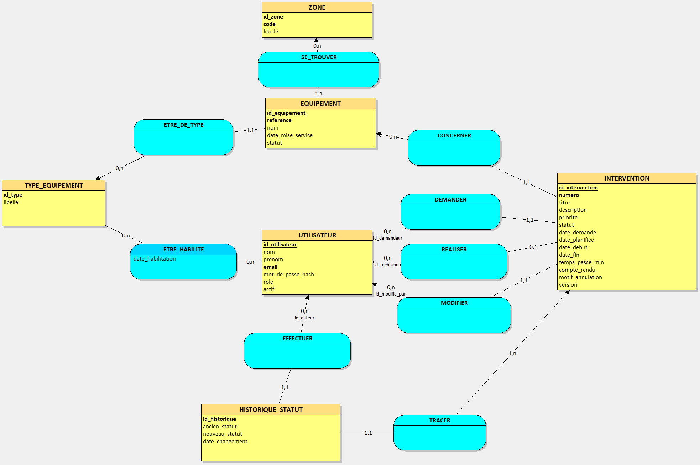
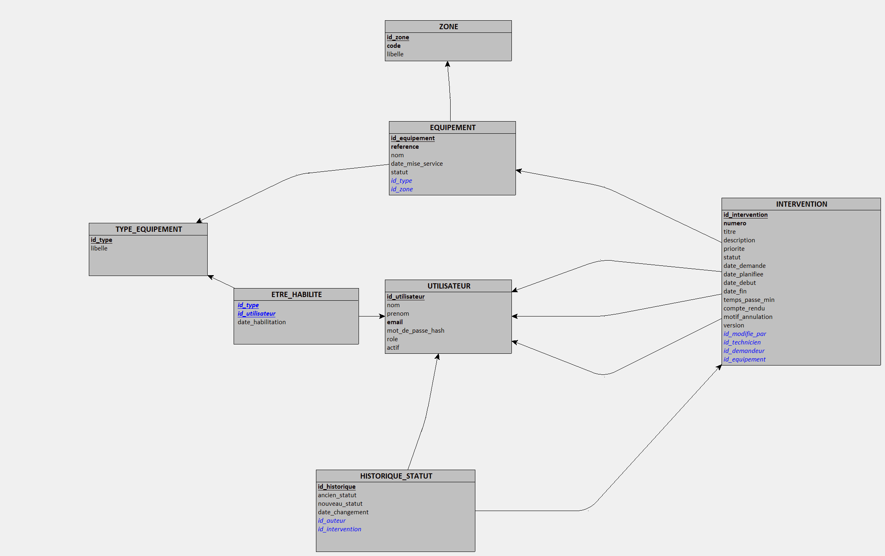

# MécaDétect


Application de suivi de maintenance industrielle : déclaration des pannes, planification des interventions et pilotage du parc d'équipements.

> 🚧 Projet en cours de développement : Sprint 4 terminé (Oracle avancé et performance), Sprint 5 en préparation (tableau de bord, export, déploiement).

## Stack technique

| Couche | Technologies |
| --- | --- |
| Back-end | Java 25 (LTS), Spring Boot 4, Spring Data JPA / Hibernate, Spring Security (JWT) |
| Base de données | Oracle Database Free, Flyway, PL/SQL |
| Front-end | Angular 21 (standalone, signals), Angular Material, RxJS |
| Contrat d'API | OpenAPI 3 en contract-first, avec génération des interfaces Spring et du client Angular |
| Tests | JUnit 5, AssertJ, Mockito, Testcontainers (Oracle), Vitest, Gatling (charge) |
| DevOps | Docker Compose, GitHub Actions |

## Points clés

- **Contract-first** : le fichier [`api/openapi.yaml`](api/openapi.yaml) est la source de vérité de l'API. Les interfaces Spring et le client Angular sont générés à chaque build : une incompatibilité entre le back et le front est détectée à la compilation.
- **Cycle de vie modélisé en Java moderne** : les transitions d'une intervention (planification, démarrage, clôture, annulation) sont une `sealed interface` de records, traitée par un `switch` à pattern matching exhaustif. Toute transition non prévue lève une exception métier, et le compilateur signale un cas oublié.
- **Concurrence maîtrisée** : verrouillage optimiste (`@Version`). Si deux responsables planifient la même intervention en même temps, le second reçoit un 409 et l'interface lui propose de recharger. Un test lance réellement les deux transactions concurrentes.
- **Règles métier garanties par la base** : contraintes nommées et `CHECK` Oracle (une intervention terminée a obligatoirement un compte rendu, une intervention annulée un motif…).
- **Sécurité** : API sans état, JWT signé via le support natif de Spring Security, autorisations par rôle, erreurs au format Problem Details (RFC 9457).
- **Performance mesurée sur 500 000 interventions** : un package PL/SQL génère 5 ans d'historique réaliste en 41 s. Plans d'exécution analysés, index ciblés, recherche construite dynamiquement (Criteria API) : la première page de la liste passe de 480 ms à moins de 7 ms. Le problème N+1 est démontré puis corrigé par un test qui compte les requêtes SQL (41 requêtes contre 2). Le détail est dans [`docs/PERFORMANCE.md`](docs/PERFORMANCE.md).
- **Tests de charge Gatling** : 35 utilisateurs simultanés (responsables, techniciens, demandeurs), avec des objectifs vérifiés automatiquement. La campagne a révélé deux défauts que les tests fonctionnels ne voyaient pas, diagnostiqués dans `V$SQL` puis corrigés : p95 de 403 ms à 21 ms, contre 3,1 s sans les index.
- **Oracle avancé** : historique des statuts alimenté par trigger, reporting en SQL analytique (`RANK`, `LAG`, calendrier `CONNECT BY`), archivage par lots en PL/SQL (`BULK COLLECT`, `FORALL`, journal en transaction autonome) appelé depuis l'API par `SimpleJdbcCall`.
- **Interface pensée pour le terrain** : la page « Mes interventions » du technicien fonctionne sur tablette, et le démarrage comme la clôture se font en 2 clics. Les boutons d'action s'affichent selon le rôle et le statut.
- **Tests sur une vraie base Oracle** grâce à Testcontainers, en local comme dans la CI. Développement des règles métier en TDD.

## Modélisation

Modèle conceptuel (méthode Merise, réalisé avec Looping) :



Modèle logique :



La [documentation technique complète](docs/MecaDetect_Documentation_technique.pdf) détaille la vision produit, l'architecture, les cas d'usage base de données et le découpage en sprints.

## Lancer le projet en local

### Prérequis

- Java 25
- Node.js (version LTS)
- Docker Desktop

### 1. La base de données

À la racine du projet, copier `.env.example` en `.env` et renseigner les valeurs, puis :

```bash
docker compose up -d
```

### 2. L'API

```bash
cd backend
mvn spring-boot:run "-Dspring-boot.run.profiles=demo"
```

L'API démarre sur http://localhost:8080. Le profil `demo` crée les comptes de démonstration. La documentation interactive est disponible sur http://localhost:8080/swagger-ui.html.

### 3. Le front-end

```bash
cd frontend
npm install
npm run generate:api
npm start
```

L'application est disponible sur http://localhost:4200.

### Comptes de démonstration

| Rôle | Email | Mot de passe |
| --- | --- | --- |
| Responsable maintenance | admin@mecadetect.fr | Demo2026! |
| Technicien | technicien@mecadetect.fr | Demo2026! |
| Demandeur | demandeur@mecadetect.fr | Demo2026! |

Ces comptes n'existent qu'avec le profil `demo`, qui crée aussi un parc de démonstration : 5 zones, 7 types et 20 équipements.

### Volume réaliste et tests de charge (optionnel)

Pour générer 500 000 interventions sur 5 ans (environ 40 s), puis lancer la campagne de charge, l'API étant démarrée :

```bash
echo "EXEC pkg_generation.generer_interventions;" | docker exec -i mecadetect-oracle bash -c 'sqlplus -s $APP_USER/$APP_USER_PASSWORD@FREEPDB1'
cd charge
mvn gatling:test
```

Le rapport HTML est produit dans `charge/target/gatling/`. Les scripts SQL de mesure (plans d'exécution, requêtes réellement exécutées, archivage à blanc) sont dans [`scripts/`](scripts/), et leur mode d'emploi est dans [`docs/PERFORMANCE.md`](docs/PERFORMANCE.md#reproduire-les-mesures).

## Parcours de démonstration

1. **Demandeur** : déclarer une panne sur la presse PRS-001. L'équipement passe « En panne ».
2. **Responsable maintenance** : ouvrir l'intervention et la planifier. Seuls les techniciens habilités sur les presses sont proposés.
3. **Technicien** : dans « Mes interventions », démarrer puis clôturer avec un compte rendu. L'équipement repasse « En service ».

## Tests

```bash
# Back-end : 206 tests (Docker doit être lancé pour Testcontainers)
cd backend
mvn verify

# Front-end : 68 tests
cd frontend
npx ng test --watch=false
```

## Avancement

| Sprint | Contenu | Statut |
| --- | --- | --- |
| 0 | Modélisation, setup, contrat OpenAPI, CI | ✅ Terminé |
| 1 | Authentification JWT, rôles, page de connexion | ✅ Terminé |
| 2 | Référentiel des équipements : CRUD, recherche paginée, liste, fiche et formulaire | ✅ Terminé |
| 3 | Interventions et cycle de vie (TDD) : déclaration, planification, réalisation, annulation, écrans par rôle | ✅ Terminé |
| 4 | Oracle avancé : trigger d'historique, génération de 500 000 interventions, reporting analytique, index et plans d'exécution, archivage PL/SQL, tests de charge Gatling | ✅ Terminé |
| 5 | Tableau de bord, export, sécurité, déploiement sur Oracle Cloud | ⏳ À venir |
| 6 | Tests end-to-end avec Robot Framework (optionnel) | ⏳ À venir |

## Auteur

**Mathieu Fenouil**, développeur full-stack Java / Angular
[LinkedIn](https://www.linkedin.com/in/mathieu-fenouil-développeur-full-stack/) · [GitHub](https://github.com/Matfen2)